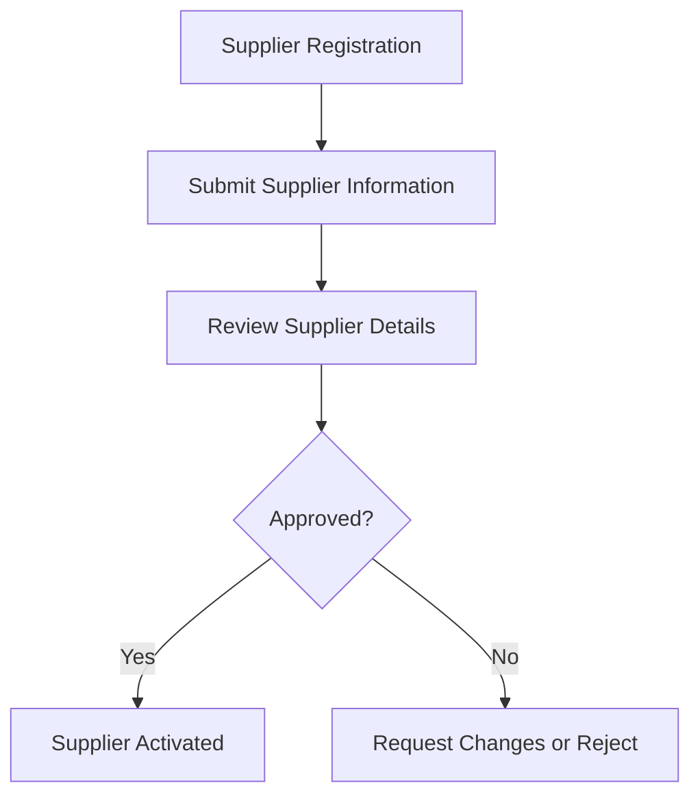
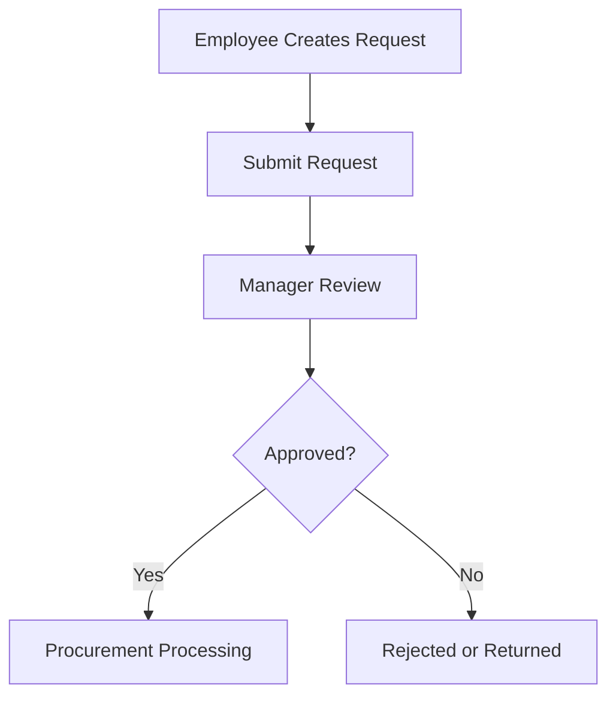
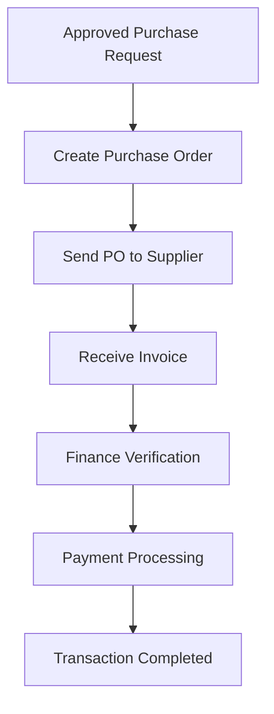

# SupplyMesh – Product Feature Specification

## 1. Product Overview

### 1.1 Introduction
SupplyMesh is a global procurement and supplier intelligence platform designed to help organizations manage suppliers, purchase requests, approvals, purchase orders, and invoices through a centralized system.

### 1.2 Product Objectives
- Simplify procurement operations.
- Improve supplier management.
- Automate approval workflows.
- Increase transparency and accountability.
- Support better purchasing decisions.

## 2. Business Problem Analysis

| Problem | Proposed Solution |
|---|---|
| Manual procurement processes | Centralized procurement management |
| Unorganized supplier information | Supplier management system |
| Slow approval processes | Automated approval workflows |
| Poor purchase tracking | Purchase order management |
| Limited visibility | Analytics and reporting |
| Lack of accountability | Audit logging |

### 2.1 Role-Based User Capability Matrix

| Feature | Owner | Procurement Manager | Department Manager | Finance Officer | Employee |
|---|---|---|---|---|---|
| Manage Organization | Yes | No | No | No | No |
| Manage Departments | Yes | No | No | No | No |
| Manage Users | Yes | No | No | No | No |
| Manage Suppliers | Yes | Yes | No | No | No |
| Submit Purchase Requests | Yes | Yes | Yes | Yes | Yes |
| Review Purchase Requests | Yes | Yes | Yes | No | No |
| Approve Purchase Requests | According to policy | According to policy | Within limits | No | No |
| Create Purchase Orders | According to policy | Yes | No | No | No |
| Review Invoices | No | Limited visibility | No | Yes | No |
| Record Payments | No | No | No | Yes | No |
| View Organization Analytics | Yes | Procurement scope | Department scope | Finance scope | Personal scope |
| View Audit Logs | Authorized scope | Authorized scope | Authorized scope | Authorized scope | No |

**Note:** The capability matrix represents proposed access boundaries. Actual permissions will be configurable and enforced through server-side authorization.

## 3. Target Users & Roles

| User Role | Key Capabilities |
|---|---|
| Organization Owner | Manage organization, users, and settings |
| Procurement Manager | Manage suppliers, requests, and purchase orders |
| Department Manager | Create requests and approve department purchases |
| Finance Officer | Manage invoices and payments |
| Employee | Submit purchase requests and track status |

## 4. Core Features

### 4.1 Authentication and User Management
- User registration and login.
- Secure password management.
- Role-based access control (RBAC).
- User invitation and account activation.
- User profile management.
- Assigning and updating user roles.
- Account suspension and deactivation.
- Session management.

### 4.2 Organization Management
- Organization registration and setup.
- Organization profile management.
- Organization-specific settings.
- Department creation and management.
- Employee assignment to departments.
- Organization member invitation.
- Organization-level access control.
- Organization data isolation.

### 4.3 Supplier Management
- Supplier registration and onboarding.
- Supplier profile creation and editing.
- Company name, contact, address, and business information management.
- Supplier categorization.
- Supplier document upload and storage.
- Supplier approval and activation.
- Supplier status management (Pending, Active, Rejected, Inactive).
- Supplier search and filtering.
- Supplier performance history.
- Supplier rating and review management.
- Supplier procurement transaction history.

### 4.4 Procurement Request Management
- Create purchase requests.
- Add item descriptions, quantities, and estimated costs.
- Select preferred suppliers.
- Assign requests to departments.
- Add supporting documents.
- Submit requests for approval.
- Edit or cancel pending requests.
- Track request status.
- View request history.
- Filter requests by status, department, date, or requester.
- View approved, rejected, and pending requests.

### 4.5 Approval Workflow Engine
- Configure approval workflows based on organizational rules.
- Assign approvers by role or department.
- Support sequential approval stages.
- Approve or reject purchase requests.
- Return requests for modification.
- Add comments during approval.
- Track approval status.
- Notify users about pending approvals.
- Maintain approval history.
- Apply approval rules based on purchase amount.

### 4.6 Purchase Order Management
- Generate purchase orders from approved requests.
- Assign unique purchase order numbers.
- Add supplier and item details.
- Specify quantity, price, and total cost.
- Manage delivery dates and terms.
- Send purchase orders to suppliers.
- Track purchase order status.
- Update order status based on progress.
- View purchase order history.
- Download purchase orders as PDF.
- Link purchase orders with invoices.

### 4.7 Invoice and Payment Management
- Upload and register supplier invoices.
- Associate invoices with purchase orders.
- Store invoice number, amount, and due date.
- Verify invoice information.
- Track invoice status.
- Detect duplicate invoice records.
- Manage payment status.
- Record payment details.
- Track outstanding and paid invoices.
- View invoice and payment history.
- Generate basic financial reports.

### 4.8 Supplier Intelligence
- Maintain supplier information in a centralized database.
- View supplier ratings and performance records.
- Track supplier delivery performance.
- Monitor supplier transaction history.
- Compare suppliers based on available information.
- Identify inactive or underperforming suppliers.
- Display supplier risk indicators based on recorded data.
- Support supplier selection during procurement.

### 4.9 Organization Analytics and Reporting
- Display procurement overview dashboards.
- Track total purchase requests.
- Monitor pending and approved requests.
- View total purchase order value.
- Track supplier activity.
- Monitor invoice and payment statuses.
- Analyze procurement spending by department.
- Generate basic procurement reports.
- Filter analytics by date range.
- Export reports for organizational use.

### 4.10 Audit Logging
- Record important user actions.
- Track request creation and modification.
- Record approval and rejection activities.
- Track purchase order changes.
- Record supplier profile updates.
- Store user, action, and timestamp information.
- View organization activity history.
- Support accountability and auditing.

## 5. Secondary Features

### 5.1 Notification System
- Email notifications for account invitations.
- Notifications for request submission.
- Approval and rejection notifications.
- Reminders for pending approvals.
- Purchase order status notifications.
- Invoice due-date reminders.
- Payment status notifications.
- In-app notification center.

### 5.2 Document Management
- Upload supplier documents.
- Attach documents to purchase requests.
- Store purchase order documents.
- Upload supplier invoices.
- Download stored documents.
- Organize documents by type.
- Restrict document access based on user roles.

### 5.3 Search and Filtering
- Search suppliers by name.
- Search purchase requests by title or ID.
- Filter requests by status.
- Filter suppliers by category or status.
- Filter purchase orders by supplier or date.
- Filter invoices by payment status.
- Sort records by date, amount, or status.

### 5.4 Reporting and Export
- Export supplier lists.
- Export purchase request records.
- Export purchase order details.
- Export invoice records.
- Generate procurement summaries.
- Download reports in CSV or PDF format.

### 5.5 User Activity History
- View recent user activities.
- Track changes to important records.
- Display request and approval history.
- View purchase order status changes.
- Support activity tracking for organization administrators.

### 5.6 Dashboard and Overview
- Display role-specific dashboards.
- Show pending tasks.
- Display recent procurement activities.
- Show request and approval summaries.
- Highlight upcoming invoice due dates.
- Provide quick access to frequently used features.

## 6. Business Rules

- Users must belong to an organization.
- Only authorized users can access organization data.
- Suppliers must be registered before being used in procurement.
- Purchase requests require approval based on organization rules.
- Approved requests can be converted into purchase orders.
- Invoices must be associated with purchase orders.
- Payment processing requires appropriate finance permissions.
- Important actions must be recorded in audit logs.

## 7. User Workflows

### 7.1 Supplier Onboarding

### 7.2 Purchase Request Approval

### 7.3 Purchase Order and Invoice Processing

## 8. Feature Dependencies

| Feature | Dependency |
|---|---|
| Supplier Management | Organization Management |
| Procurement Requests | Authentication and Organization |
| Approval Workflow | Procurement Requests and User Roles |
| Purchase Orders | Approved Procurement Requests |
| Invoice Management | Purchase Orders |
| Payment Management | Invoice Management |
| Analytics | Procurement and Supplier Data |
| Notifications | User Management and Business Events |
| Audit Logging | Authentication and Core Modules |

## 9. Feature Prioritization Matrix

| Priority | Features |
|---|---|
| Must Have | Authentication, Organization Management, Supplier Management, Procurement Requests, Basic Approval Workflow, Purchase Order Management |
| Should Have | Invoice Management, Payment Tracking, Notifications, Audit Logging, Document Management |
| Could Have | Advanced Supplier Intelligence, Analytics Dashboard, Report Export, Advanced Search |
| Won't Have (For Now) | AI-based Procurement Predictions, Advanced ERP Integrations, Automated Global Payment Processing |

## 10. System Limitations

- Initial version supports basic procurement workflows.
- Supplier intelligence is limited to available data.
- Advanced analytics and AI-based recommendations are not included in the MVP.
- External ERP and payment integrations are postponed.
- Workflow customization is limited to predefined rules.

## 11. MVP Scope

The MVP will include:

- Authentication and role-based access control.
- Organization and user management.
- Supplier management.
- Procurement request creation.
- Basic approval workflows.
- Purchase order creation and tracking.
- Basic invoice management.
- Audit logging.

### MVP Success Criteria

- Users can manage procurement through a centralized platform.
- Purchase requests can be submitted and approved.
- Approved requests can generate purchase orders.
- Suppliers and procurement records can be tracked.
- Access is controlled according to user roles.

## 12. Future Expansion Scope

- AI-powered supplier recommendations.
- Advanced procurement analytics.
- Automated supplier risk assessment.
- ERP and accounting integrations.
- Advanced workflow customization.
- Global payment integrations.
- Predictive procurement insights.
- Automated invoice data extraction.
- Advanced supplier benchmarking.

## 13. MVP Prioritization Justification

The MVP focuses on essential procurement operations, including supplier management, request submission, approvals, and purchase orders. These features establish the core business workflow.

Advanced analytics, AI recommendations, ERP integrations, and automated global payments are postponed because they require additional complexity, integrations, and data. They can be introduced after the core platform is stable and validated.

## 14. Conclusion

SupplyMesh aims to streamline procurement by providing a centralized platform for supplier management, purchase requests, approvals, purchase orders, and financial tracking. The MVP establishes the essential workflow, while future expansions will enhance intelligence, automation, and scalability.