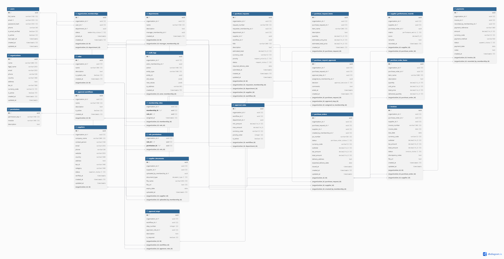

# Database Design

## 1. Database Overview

SupplyMesh uses PostgreSQL as its primary relational database. The database is designed to manage organizational procurement operations, supplier information, approval workflows, purchase orders, invoices, payments, and audit records.

### Database Objectives

- Maintain structured and consistent organizational data.
- Support relationships between procurement entities.
- Enforce data integrity through database constraints.
- Provide secure organization-level data isolation.
- Support efficient queries as organizational data grows.
- Allow future expansion of procurement features.

## 2. Entity Relationship Diagram (ERD)

The ER diagram illustrates the database tables, their attributes, primary keys, foreign keys, and relationships.

**Interactive Diagram:** [View SupplyMesh ER Diagram on dbdiagram.io](https://dbdiagram.io/d/6afb14b0d4a729077dfeda3e)

## 3. Table Definitions

The database contains the following main tables.

### 3.1 Organization and User Management

| Table | Purpose | Important Columns |
|---|---|---|
| organizations | Stores organization information | id, name, legal_name, email, country |
| users | Stores user account information | id, full_name, email, password_hash |
| departments | Stores organization departments | id, organization_id, name, manager_membership_id |
| organization_memberships | Connects users with organizations and departments | id, organization_id, user_id, department_id, status |

### 3.2 Role-Based Access Control

| Table | Purpose | Important Columns |
|---|---|---|
| roles | Stores organization-specific roles | id, organization_id, name |
| permissions | Stores available system permissions | id, permission_key, module |
| membership_roles | Assigns roles to organization memberships | organization_id, membership_id, role_id |
| role_permissions | Connects roles with permissions | organization_id, role_id, permission_id |

### 3.3 Supplier Management

| Table | Purpose | Important Columns |
|---|---|---|
| suppliers | Stores supplier profiles | id, organization_id, company_name, email, status |
| supplier_documents | Stores supplier document references | id, organization_id, supplier_id, document_type, file_url |
| supplier_performance_records | Stores supplier performance information | id, organization_id, supplier_id, metric, score |

### 3.4 Procurement Request Management

| Table | Purpose | Important Columns |
|---|---|---|
| purchase_requests | Stores purchase requests | id, organization_id, requester_membership_id, department_id, status |
| purchase_request_items | Stores individual items in purchase requests | id, organization_id, purchase_request_id, item_name, quantity |

### 3.5 Approval Workflow Management

| Table | Purpose | Important Columns |
|---|---|---|
| approval_workflows | Stores configurable approval workflows | id, organization_id, name, is_active |
| approval_rules | Defines approval conditions | id, organization_id, workflow_id, min_amount, max_amount |
| approval_steps | Defines individual workflow steps | id, organization_id, workflow_id, step_number, approver_role_id |
| purchase_request_approvals | Tracks approval decisions for requests | id, organization_id, purchase_request_id, approval_step_id, decision |

### 3.6 Purchase Order Management

| Table | Purpose | Important Columns |
|---|---|---|
| purchase_orders | Stores purchase order records | id, organization_id, purchase_request_id, supplier_id, po_number, status |
| purchase_order_items | Stores items belonging to purchase orders | id, organization_id, purchase_order_id, item_name, quantity, unit_price |

### 3.7 Invoice and Payment Management

| Table | Purpose | Important Columns |
|---|---|---|
| invoices | Stores supplier invoice information | id, organization_id, purchase_order_id, invoice_number, total_amount, status |
| payments | Stores invoice payment records | id, organization_id, invoice_id, amount, payment_method, status |

### 3.8 Audit Management

| Table | Purpose | Important Columns |
|---|---|---|
| audit_logs | Records important system activities | id, organization_id, actor_membership_id, action, entity_type, entity_id |

## 4. Primary and Foreign Keys

### 4.1 Primary Keys (PK)

Every main entity table uses a UUID primary key to uniquely identify its records.

Examples:

- `organizations.id`
- `users.id`
- `suppliers.id`
- `purchase_requests.id`
- `purchase_orders.id`
- `invoices.id`

The `membership_roles` and `role_permissions` tables use composite primary keys to prevent duplicate role assignments and permission mappings.

### 4.2 Foreign Keys (FK)

Foreign keys maintain relationships and prevent references to non-existing records.

Examples:

| Foreign Key | References |
|---|---|
| departments.organization_id | organizations.id |
| organization_memberships.user_id | users.id |
| suppliers.organization_id | organizations.id |
| purchase_requests.department_id | departments.id |
| purchase_request_items.purchase_request_id | purchase_requests.id |
| approval_steps.workflow_id | approval_workflows.id |
| purchase_orders.purchase_request_id | purchase_requests.id |
| invoices.purchase_order_id | purchase_orders.id |
| payments.invoice_id | invoices.id |

### 4.3 Composite Foreign Keys

Tenant-owned records use composite foreign keys containing `organization_id` where appropriate.

For example:

`(organization_id, purchase_request_id)` references `(organization_id, id)` in `purchase_requests`.

This helps prevent a record from referencing another organization's entity.

## 5. Relationship Explanations

| Relationship | Type | Explanation |
|---|---|---|
| Organization → Departments | One-to-Many | An organization can have multiple departments. |
| Organization → Memberships | One-to-Many | An organization can have multiple members. |
| User → Memberships | One-to-Many | A user can belong to multiple organizations. |
| Membership → Roles | Many-to-Many | A membership can have multiple roles. |
| Role → Permissions | Many-to-Many | A role can contain multiple permissions. |
| Organization → Suppliers | One-to-Many | An organization can manage multiple suppliers. |
| Supplier → Documents | One-to-Many | A supplier can have multiple documents. |
| Department → Purchase Requests | One-to-Many | A department can create multiple purchase requests. |
| Purchase Request → Items | One-to-Many | A request can contain multiple items. |
| Workflow → Approval Steps | One-to-Many | A workflow can contain multiple approval steps. |
| Purchase Request → Approvals | One-to-Many | A request can have multiple approval records. |
| Purchase Request → Purchase Orders | One-to-Many | A request may generate multiple purchase orders when split across suppliers. |
| Purchase Order → Items | One-to-Many | A purchase order can contain multiple items. |
| Purchase Order → Invoices | One-to-Many | A purchase order can have multiple invoices. |
| Invoice → Payments | One-to-Many | An invoice can have multiple partial payments. |
| Supplier → Performance Records | One-to-Many | A supplier can have multiple performance records. |

## 6. Important Database Constraints

Database constraints help maintain data accuracy and consistency.

### Primary Key Constraints
Every main entity has a unique primary key.

### Foreign Key Constraints
Related records must reference valid parent records.

### Unique Constraints
Examples:

- User email must be unique.
- Organization membership must be unique for each organization-user combination.
- Department names must be unique within an organization.
- Purchase request numbers must be unique within an organization.
- Purchase order numbers must be unique within an organization.
- Supplier invoice numbers must be unique within an organization and supplier.

### NOT NULL Constraints

Important fields such as organization IDs, user emails, supplier names, request titles, and transaction amounts must not be null.

### CHECK Constraints

Additional validation should enforce rules such as:

- Quantity must be greater than zero.
- Monetary amounts must not be negative.
- Approval step numbers must be positive.
- Supplier performance scores must remain within the defined scoring range.
- Maximum approval amounts must be greater than minimum amounts when specified.
- Delivered quantity must not exceed ordered quantity.

### ENUM Constraints

Enums restrict status fields to predefined values.

Examples include:

- `supplier_status`
- `request_status`
- `approval_decision`
- `purchase_order_status`
- `invoice_status`
- `payment_status`

## 7. Indexing Strategy

Indexes are used to improve query performance, especially when organizational records grow.

| Table | Indexed Columns | Purpose |
|---|---|---|
| users | email | Fast user lookup and unique email validation |
| departments | organization_id, name | Department lookup within an organization |
| suppliers | organization_id, status | Supplier filtering |
| suppliers | organization_id, category | Supplier category filtering |
| purchase_requests | organization_id, status, created_at | Request filtering and date-based sorting |
| purchase_orders | organization_id, po_number | Purchase order lookup |
| invoices | organization_id, status, due_date | Invoice and due-date filtering |
| payments | organization_id, invoice_id | Payment history lookup |
| audit_logs | organization_id, created_at | Organization activity history |
| audit_logs | organization_id, entity_type, entity_id | Entity-specific audit history |

### Indexing Decisions

- Use indexes on frequently searched columns.
- Use composite indexes for common organization-scoped queries.
- Use unique indexes to prevent duplicate records.
- Avoid unnecessary indexes because they increase storage requirements and write overhead.
- Review query execution plans before adding additional indexes.

## 8. Data Normalization Strategy

The database follows relational normalization principles to reduce duplication and maintain data consistency.

### First Normal Form (1NF)

- Each column stores a single value.
- Repeating groups are separated into individual records.
- Purchase request items and purchase order items use separate tables.

### Second Normal Form (2NF)

- Every non-key attribute depends on the complete primary key.
- Junction tables such as `membership_roles` and `role_permissions` use composite primary keys.
- Role and permission information is stored separately.

### Third Normal Form (3NF)

- Non-key attributes depend on their table's primary key rather than other non-key attributes.
- Organization, supplier, user, invoice, and payment information are maintained in separate tables.
- Repeated supplier and user information is not unnecessarily duplicated across procurement records.

### Normalization Decision

The design primarily follows 3NF to reduce data duplication and improve consistency. Some transaction amounts and historical information are stored as snapshots where necessary to preserve procurement and financial records.

## 9. Multi-Tenant Data Isolation Strategy

SupplyMesh uses a shared database and shared schema multi-tenant architecture.

Each organization shares the same database structure, but organization-owned records contain an `organization_id`.

### Isolation Approach

1. Every organization has a unique ID.
2. Organization memberships connect users to organizations.
3. Tenant-owned records store their organization ID.
4. Backend services derive the active organization from the authenticated membership.
5. All organization-scoped queries validate the user's membership and permissions.
6. Composite foreign keys help prevent cross-organization relationships.
7. PostgreSQL Row-Level Security (RLS) can provide an additional database-level protection layer.

### Example

If Organization A and Organization B use SupplyMesh, both organizations can have suppliers with their own records.

However, users from Organization A must not be able to access Organization B's supplier information.

The backend enforces this boundary on every relevant operation.

## 10. Handling Growing Organizational Data

The database is designed to support increasing numbers of organizations, users, suppliers, and procurement transactions.

### Scalability Strategies

- **Index Optimization:** Add indexes based on frequently executed queries.
- **Connection Pooling:** Manage database connections efficiently.
- **Query Optimization:** Avoid unnecessary queries and retrieve only required data.
- **Pagination:** Load large supplier, request, invoice, and audit-log lists in smaller pages.
- **Caching:** Use Redis for frequently accessed data where appropriate.
- **Read Replicas:** Introduce read replicas if read traffic becomes high.
- **Partitioning:** Consider partitioning large audit-log or transaction tables when data volume justifies it.
- **Archiving:** Move old records to appropriate archival storage based on retention policies.
- **Monitoring:** Monitor query performance, storage usage, and database resource consumption.

These strategies can be introduced gradually as platform usage increases.

## 11. Database Selection and Alternatives

### Selected Database: PostgreSQL

PostgreSQL was selected because SupplyMesh requires reliable relationships, transaction consistency, structured data, and complex queries across procurement operations.

### Why PostgreSQL?

- Strong relational data integrity.
- Support for primary keys, foreign keys, and complex constraints.
- ACID-compliant transactions.
- UUID and JSONB support.
- Indexing and query optimization capabilities.
- Row-Level Security support for multi-tenant protection.
- Suitable for complex procurement and financial workflows.

### Alternatives Considered

| Database | Advantages | Limitations for SupplyMesh |
|---|---|---|
| PostgreSQL | Strong relational integrity, advanced queries, transactions, and RLS | Requires thoughtful schema and query management |
| MySQL | Popular relational database with good performance | PostgreSQL provides a stronger fit for the planned combination of RLS, JSONB, and relational features |
| MongoDB | Flexible document structure and schema evolution | Complex relationships and transactional procurement workflows require additional modeling |

### Final Decision

PostgreSQL provides the best fit for the current requirements because SupplyMesh contains highly related entities and requires consistent financial and procurement transactions.

## 12. Database Design Decisions

| Decision | Justification |
|---|---|
| UUID Primary Keys | Provides unique identifiers across distributed environments |
| Relational Database | Maintains structured relationships and data integrity |
| Shared Multi-Tenant Schema | Reduces infrastructure complexity while supporting multiple organizations |
| Separate Membership Table | Allows users to belong to multiple organizations |
| RBAC Tables | Supports configurable roles and permissions |
| Separate Item Tables | Allows multiple items per request and purchase order |
| Separate Invoice and Payment Tables | Supports multiple and partial payments |
| Audit Logs | Maintains a record of important organizational activities |
| Composite Foreign Keys | Helps enforce organization-level relationship integrity |

## 13. Conclusion

The SupplyMesh database uses PostgreSQL and a normalized relational structure to support multi-tenant procurement operations.

The design provides a foundation for organization management, supplier intelligence, procurement requests, approval workflows, purchase orders, invoices, payments, and auditing.

Its indexing, isolation, and scalability strategies are intended to support growing organizational data while maintaining consistency, security, and performance.