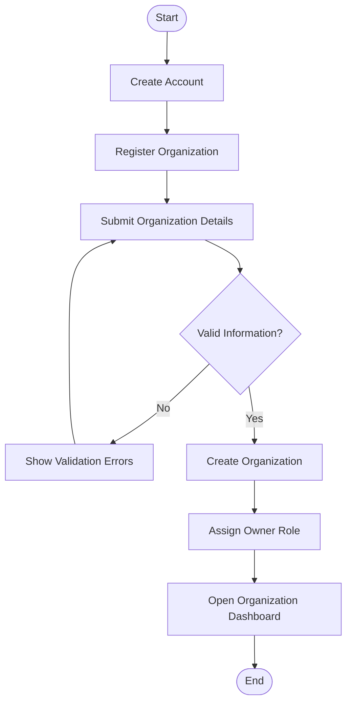
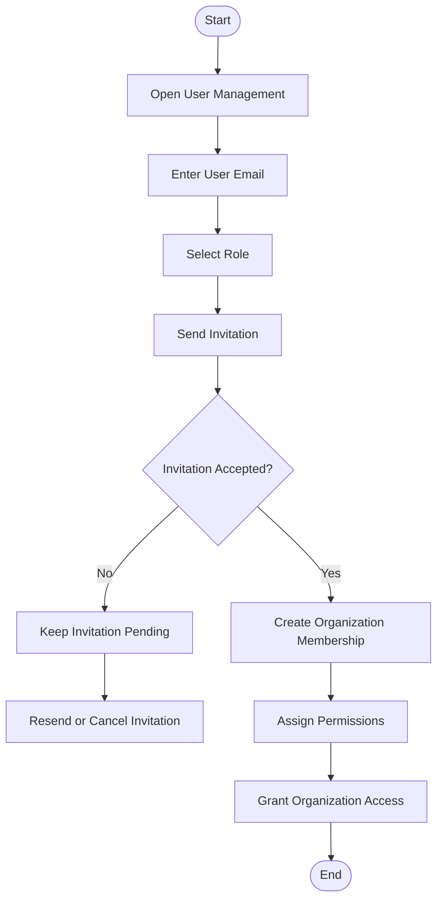
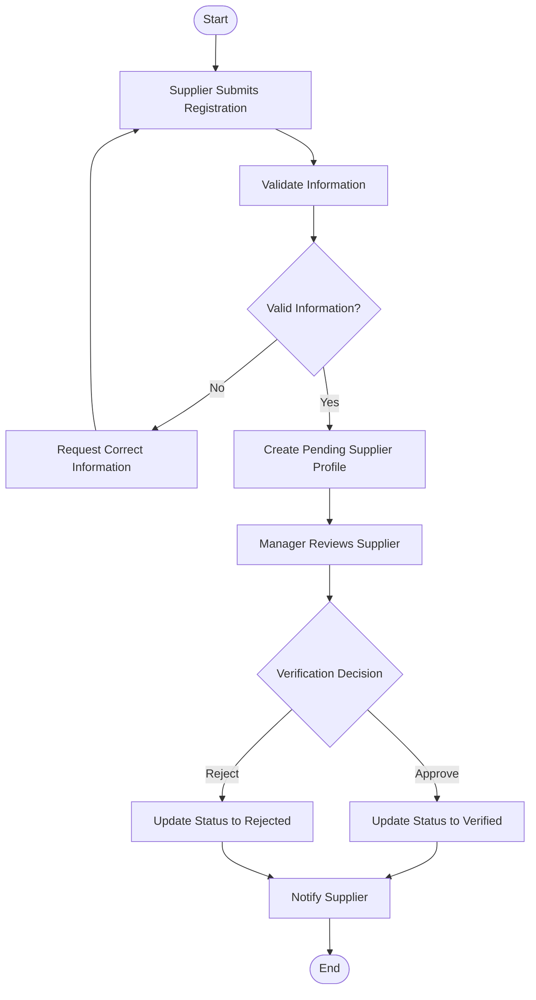
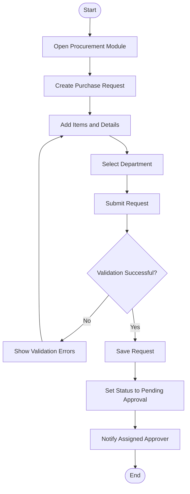
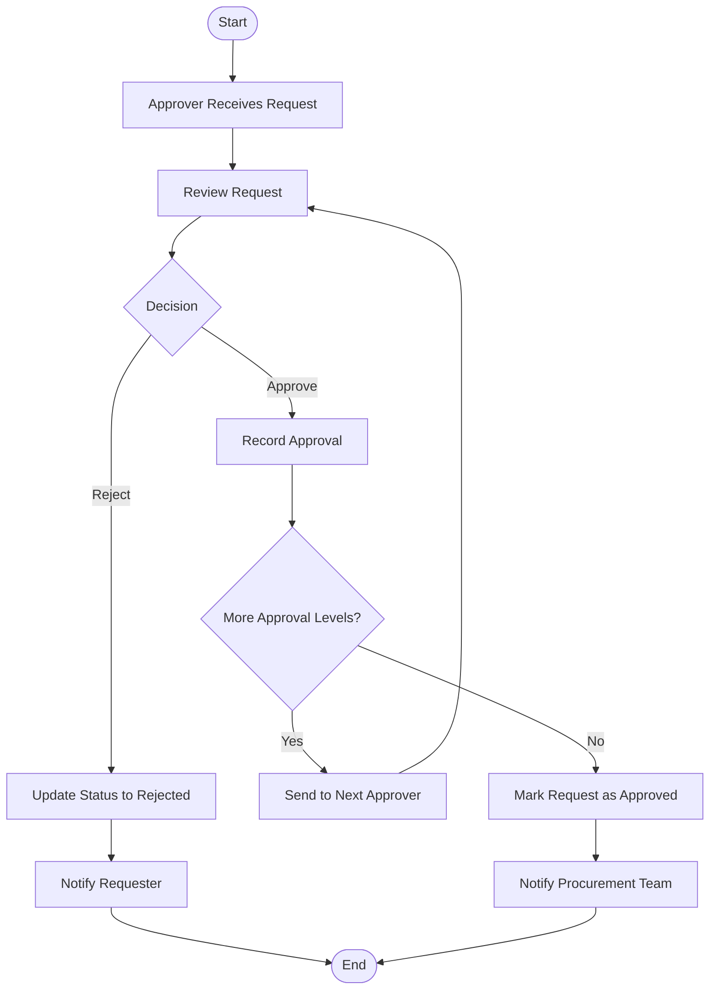
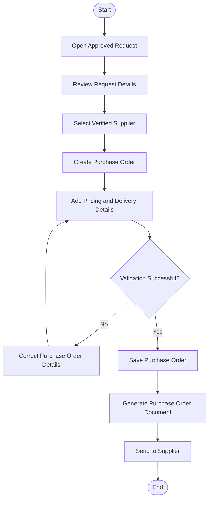
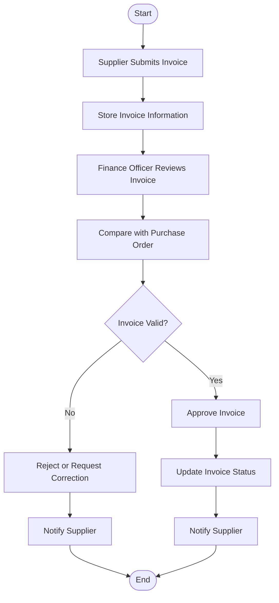
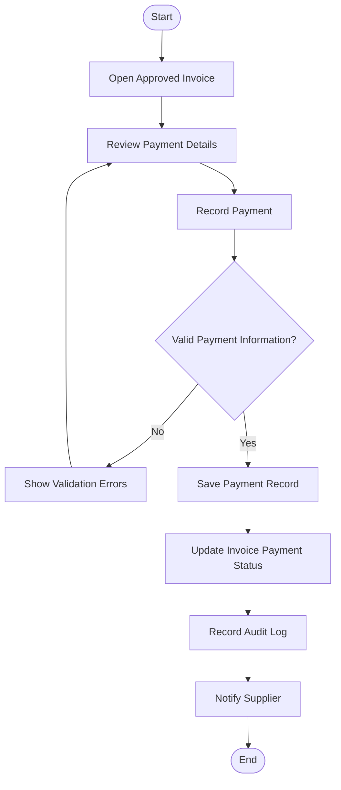

# SupplyMesh - User Journey Diagrams

## 1. Overview

User Journey Diagrams illustrate how different users interact with the SupplyMesh platform to complete important business activities.

These diagrams represent the main workflows, user actions, system responses, and alternative paths throughout the procurement lifecycle.

## 2. Actors

| Actor | Responsibility |
|---|---|
| Organization Owner | Manages the organization, users, and settings |
| Procurement Manager | Manages suppliers and procurement activities |
| Department Manager | Reviews and approves purchase requests |
| Employee | Creates and submits purchase requests |
| Finance Officer | Manages invoices and payment records |
| Supplier | Registers and provides goods or services |

## 3. Organization Registration and Setup

**Actor:** Organization Owner

**Journey:**
1. Visits the SupplyMesh platform.
2. Creates an account.
3. Registers an organization.
4. Provides organization details.
5. The system validates the information.
6. The organization is created.
7. The owner accesses the organization dashboard.

## 4. User Invitation and Role Assignment

**Actor:** Organization Owner

**Journey:**
1. Opens user management.
2. Enters the new user's email.
3. Selects a role.
4. Sends an invitation.
5. The system sends an invitation email.
6. The invited user accepts the invitation.
7. The system creates the organization membership.
8. The user receives access according to their assigned permissions.

## 5. Supplier Registration and Verification

**Actor:** Supplier, Procurement Manager

**Journey:**
1. Supplier submits registration information.
2. The system validates the submitted information.
3. Supplier profile is created with pending status.
4. Procurement Manager reviews the information.
5. The manager approves or rejects the supplier.
6. The system updates the supplier status.
7. The supplier is notified of the decision.

## 6. Procurement Request Creation and Submission

**Actor:** Employee

**Journey:**
1. Opens the procurement module.
2. Creates a new purchase request.
3. Adds items, quantities, and descriptions.
4. Selects the relevant department.
5. Submits the request.
6. The system validates the request.
7. The request is saved with a pending approval status.
8. The assigned approver receives a notification.

## 7. Multi-Level Approval Workflow

**Actor:** Department Manager, Procurement Manager

**Journey:**
1. Approver receives a purchase request.
2. Reviews the request details.
3. Checks the budget and business justification.
4. Approves or rejects the request.
5. If another approval level is required, the request moves to the next approver.
6. Once all required approvals are completed, the request becomes approved.
7. If rejected, the request status is updated and the requester is notified.

## 8. Purchase Order Generation

**Actor:** Procurement Manager

**Journey:**
1. Opens an approved procurement request.
2. Reviews the approved request details.
3. Selects a verified supplier.
4. Creates a purchase order.
5. Adds item prices, quantities, and delivery information.
6. The system validates the purchase order.
7. The purchase order is saved.
8. The supplier receives the purchase order.

## 9. Invoice Submission and Verification

**Actor:** Supplier, Finance Officer

**Journey:**
1. Supplier submits an invoice against a purchase order.
2. The system stores the invoice information.
3. Finance Officer reviews the invoice.
4. Checks the invoice against the purchase order.
5. Approves or rejects the invoice.
6. The system updates the invoice status.
7. The supplier is notified of the result.

## 10. Payment Processing

**Actor:** Finance Officer

**Journey:**
1. Opens an approved invoice.
2. Reviews the payment details.
3. Records the payment transaction.
4. The system validates the payment information.
5. The payment record is saved.
6. The invoice payment status is updated.
7. The supplier is notified of the payment update.

## 11. Conclusion

These user journeys describe the main interactions between SupplyMesh users and the platform. They cover organization setup, user management, supplier verification, procurement requests, approvals, purchase orders, invoice verification, and payment processing.

