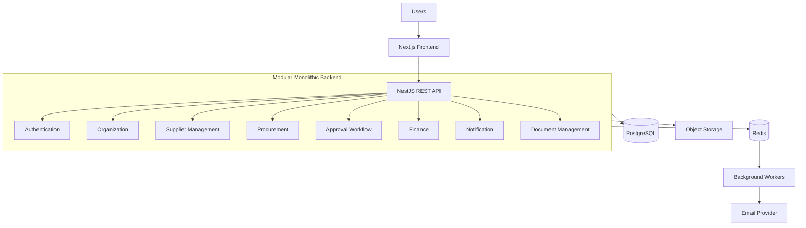

# Application Architecture

## 1. Architecture Overview

SupplyMesh follows a **Modular Monolithic Architecture**.

The frontend uses Next.js and TypeScript, while the backend uses NestJS. The backend is divided into separate modules based on business responsibilities but deployed as a single application.

### Selected Architecture: Modular Monolith

**Why Modular Monolith?**

- Easy to develop, maintain, and deploy.
- Clear separation between business modules.
- Less operational complexity than microservices.
- Suitable for the initial MVP.
- Allows future migration of individual modules into microservices if needed.

Microservices and SOA were considered but not selected because they would introduce unnecessary complexity at the current stage.

## 2. High-Level Architecture Diagram

## 3. Frontend Architecture

**Technology:** Next.js, React, TypeScript, Tailwind CSS.

The frontend is organized into feature-based components.

Main responsibilities:

- User authentication and dashboards.
- Organization and supplier management.
- Procurement and approval interfaces.
- Purchase orders and invoice management.
- API communication and form validation.
- Role-based navigation and UI visibility.

## 4. Backend Architecture

**Technology:** Node.js, NestJS, TypeScript, Drizzle ORM.

The backend contains separate modules:

| Module | Responsibility |
|---|---|
| Authentication | Login, registration, token management |
| Organization | Organizations, departments, memberships |
| Authorization | Roles and permissions |
| Supplier | Supplier profiles and documents |
| Procurement | Purchase requests |
| Approval | Approval workflows |
| Purchase Order | Purchase order management |
| Finance | Invoices and payments |
| Notification | In-app and email notifications |
| Document | File management |
| Audit | Activity tracking |
| Analytics | Reports and dashboards |

Each module contains controllers, services, and data access logic.

## 5. API Structure

SupplyMesh uses versioned REST APIs.

Base URL: `/api/v1`

| Module | Example Endpoint |
|---|---|
| Authentication | `/auth/login` |
| Organization | `/organizations` |
| Suppliers | `/suppliers` |
| Procurement | `/purchase-requests` |
| Approvals | `/approvals/:id/decision` |
| Purchase Orders | `/purchase-orders` |
| Finance | `/invoices` |
| Notifications | `/notifications` |
| Analytics | `/analytics/overview` |

APIs use standard HTTP methods, request validation, consistent responses, and pagination.

## 6. Authentication Architecture

SupplyMesh uses token-based authentication.

- Users register and log in using their credentials.
- Passwords are securely hashed.
- The backend verifies credentials.
- Short-lived access tokens are issued.
- Refresh tokens are managed using secure HTTP-only cookies.
- Protected API requests require valid authentication.

## 7. Authorization Architecture

SupplyMesh uses **Role-Based Access Control (RBAC)**.

- Users receive roles through organization memberships.
- Roles contain specific permissions.
- The backend checks permissions before allowing operations.
- Organization membership and resource ownership are also verified.

Frontend access restrictions are for UI purposes only. The backend enforces actual permissions.

## 8. Database Communication

**Database:** PostgreSQL  
**ORM:** Drizzle ORM

The communication flow:

1. Frontend sends an API request.
2. Controller validates the request.
3. Service executes business logic.
4. Data access layer communicates with PostgreSQL.
5. Database returns the result.
6. Backend sends the response to the frontend.

Database transactions maintain consistency when multiple related records are updated.

## 9. File and Document Storage

SupplyMesh uses S3-compatible object storage for uploaded documents.

- Actual files are stored in object storage.
- PostgreSQL stores document metadata and storage references.
- Private files are accessible only to authorized users.
- Signed URLs provide temporary access to files.

## 10. Notification System

SupplyMesh supports:

- **In-App Notifications:** Stored in PostgreSQL and displayed in the application.
- **Email Notifications:** Sent through an external email provider.

Notifications are triggered by events such as purchase request submission, approval, rejection, and payment updates.

## 11. Background Processing

SupplyMesh uses Redis with a background job queue such as BullMQ.

Background workers handle:

- Sending emails.
- Processing documents.
- Generating reports.
- Scheduled tasks.
- Retrying failed jobs.

This prevents time-consuming operations from blocking API requests.

## 12. Caching Strategy

**Caching Technology:** Redis

Redis stores frequently accessed data, such as:

- Dashboard summaries.
- Organization settings.
- Reference data.
- Frequently requested information.

Cache expiration and invalidation policies keep cached data reasonably up to date. Organization-specific cache keys prevent data mixing between tenants.

## 13. Scalability

The architecture supports future growth through:

- Database indexing and query optimization.
- Connection pooling.
- Redis caching.
- Pagination for large datasets.
- Separate background workers.
- Object storage for documents.
- Read replicas and table partitioning when needed.

Individual backend modules can be extracted into microservices if future requirements justify it.

## 14. Conclusion

SupplyMesh uses a Modular Monolithic Architecture with Next.js, NestJS, PostgreSQL, Redis, and object storage.

This architecture provides a simple, maintainable, and scalable foundation for the MVP while allowing future expansion as the platform grows.