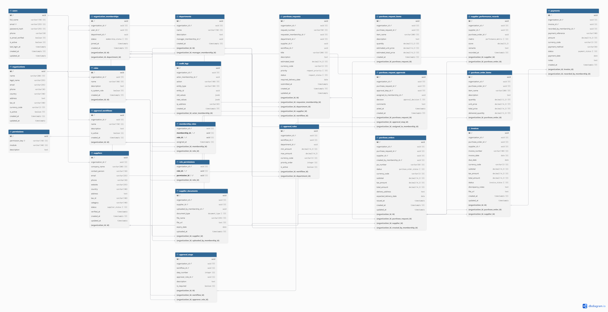

# SupplyMesh Entity Relationship Diagram (ERD)

## 1. Overview

The SupplyMesh Entity Relationship Diagram represents the database structure of the Global Procurement & Supplier Intelligence Platform.

It illustrates the database entities, their attributes, primary keys, foreign keys, and relationships.

## 2. Interactive ER Diagram

[View SupplyMesh ER Diagram on dbdiagram.io](https://dbdiagram.io/d/6afb14b0d4a729077dfeda3e)

## 3. ER Diagram

The exported ER diagram is shown below.

## 4. Diagram Coverage

The ER diagram represents the following major areas:

- Organization and User Management
- Role-Based Access Control
- Supplier Management
- Procurement Request Management
- Approval Workflow Management
- Purchase Order Management
- Invoice and Payment Management
- Audit Management
