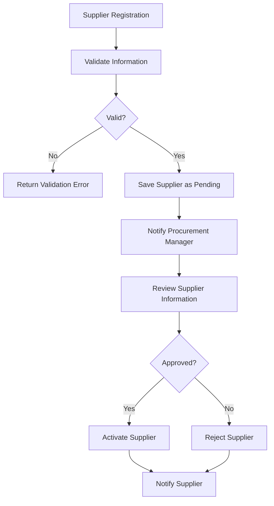
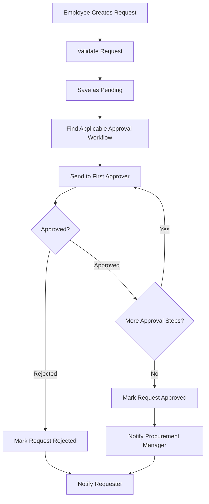
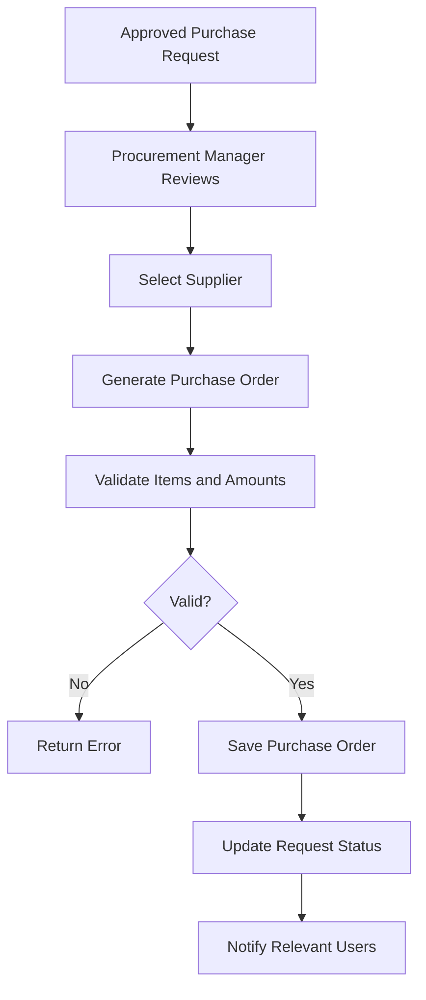
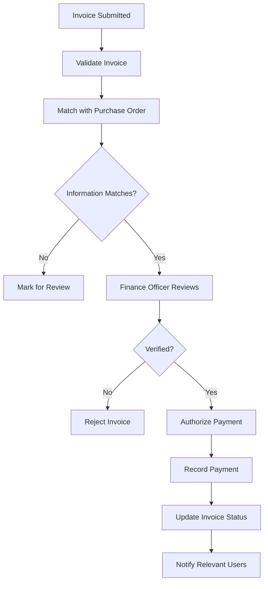

# System Design

## 1. Overview

SupplyMesh uses a Modular Monolithic Architecture to manage procurement operations.

This document explains four critical workflows:

1. Supplier Registration and Verification.
2. Purchase Request and Multi-Level Approval.
3. Purchase Order Generation.
4. Invoice Verification and Payment Processing.

---

## 2. Supplier Registration and Verification

### Workflow

### Request Flow

1. Supplier submits registration information.
2. Backend validates the information and documents.
3. Supplier record is created with Pending status.
4. Procurement Manager reviews the submission.
5. Manager approves or rejects the supplier.

### Business Logic

- Validate required supplier information.
- Check duplicate supplier records within the organization.
- Require necessary documents.
- Only authorized users can verify suppliers.
- Approved suppliers become available for procurement.

### Database Operations

- Insert supplier information into `suppliers`.
- Store document references in `supplier_documents`.
- Update supplier verification status.
- Record activities in `audit_logs`.

### Authorization Checks

- Supplier registration requires valid access.
- Only authorized Procurement Managers or Owners can verify suppliers.
- Supplier records must belong to the active organization.

### Failure Scenarios

- Invalid registration information.
- Duplicate supplier information.
- Missing or invalid documents.
- Unauthorized verification attempts.
- Object storage upload failure.

### Transaction Handling

Supplier creation and related database records should be handled within a database transaction. File uploads should be managed separately, with cleanup or retry handling if the database operation fails.

### Notification Flow

Notify the Procurement Manager when a supplier registers. Notify the relevant users when the supplier is approved or rejected.

---

## 3. Purchase Request and Multi-Level Approval

### Workflow

### Request Flow

1. Employee submits a purchase request.
2. Backend validates request details and items.
3. System identifies the applicable approval workflow.
4. Request is sent to the first approver.
5. Each approver reviews and approves or rejects it.
6. After all required approvals, the request becomes Approved.

### Business Logic

- Validate requested items and quantities.
- Determine approval rules based on amount or department.
- Follow approval steps in the configured order.
- Prevent unauthorized approval decisions.
- Stop the workflow when a request is rejected.

### Database Operations

- Insert into `purchase_requests`.
- Insert request items into `purchase_request_items`.
- Retrieve rules from `approval_workflows` and `approval_rules`.
- Retrieve steps from `approval_steps`.
- Save decisions in `purchase_request_approvals`.
- Update request status.
- Record activities in `audit_logs`.

### Authorization Checks

- Authenticated organization members can submit requests.
- Only assigned and authorized approvers can make decisions.
- Approvers must belong to the correct organization.
- Users cannot approve their own requests unless organizational policy explicitly allows it.

### Failure Scenarios

- Invalid request information.
- No applicable approval workflow.
- Approver lacks permission.
- Duplicate approval submission.
- Approver account becomes inactive.

### Transaction Handling

Saving the request and its items should happen in one database transaction.

Each approval decision and its corresponding request status update should also be handled transactionally. Background jobs can notify the next approver after the transaction succeeds.

### Notification Flow

- Notify the first approver when a request is submitted.
- Notify the next approver after each approval.
- Notify the requester when the request is approved or rejected.
- Notify procurement users when the request is fully approved.

---

## 4. Purchase Order Generation

### Workflow

### Request Flow

1. Procurement Manager selects an approved purchase request.
2. Manager selects an appropriate supplier.
3. Backend validates the request and supplier.
4. System generates a purchase order.
5. Purchase order and its items are saved.
6. Relevant users are notified.

### Business Logic

- Only approved requests can generate purchase orders.
- Supplier must be active and belong to the organization.
- Purchase order items must match the approved request.
- Generate a unique purchase order number.
- Calculate item totals and the final order amount.

### Database Operations

- Retrieve data from `purchase_requests`.
- Retrieve supplier information from `suppliers`.
- Insert into `purchase_orders`.
- Insert items into `purchase_order_items`.
- Update the purchase request status where appropriate.
- Record the operation in `audit_logs`.

### Authorization Checks

- Only authorized Procurement Managers or Owners can create purchase orders.
- The request and supplier must belong to the active organization.
- The request must have an approved status.

### Failure Scenarios

- Request is not approved.
- Supplier is inactive.
- Invalid order items.
- Duplicate purchase order number.
- Database or storage failure.

### Transaction Handling

Purchase order creation, item insertion, and request status updates should happen in one database transaction.

If any database operation fails, the transaction is rolled back.

### Notification Flow

Notify relevant procurement users and the requester when a purchase order is generated. Supplier communication can be handled through an email notification or document-sharing process.

---

## 5. Invoice Verification and Payment Processing

### Workflow

### Request Flow

1. Invoice information and document are submitted.
2. Backend validates invoice details.
3. System matches the invoice with the related purchase order.
4. Finance Officer reviews the invoice.
5. Authorized Finance Officer records the payment.
6. Invoice status is updated.
7. Relevant users receive notifications.

### Business Logic

- Validate invoice number and amount.
- Check for duplicate invoices.
- Match invoice details with purchase order information.
- Verify received goods or services where applicable.
- Allow partial payments when permitted.
- Mark invoices as partially paid or paid based on outstanding balance.

### Database Operations

- Insert invoice information into `invoices`.
- Store invoice document references in `supplier_documents` or an appropriate document record.
- Retrieve related purchase order information.
- Insert payment records into `payments`.
- Update invoice payment status.
- Record activities in `audit_logs`.

### Authorization Checks

- Only authorized Finance Officers or Owners can verify invoices.
- Only authorized users can record payments.
- Invoice and purchase order must belong to the same organization.
- Users cannot record payments exceeding the outstanding balance.

### Failure Scenarios

- Duplicate invoice number.
- Invoice does not match the purchase order.
- Invalid invoice amount.
- Unauthorized payment attempt.
- Payment provider or bank processing failure.
- Database update failure.

### Transaction Handling

Invoice verification and payment recording must maintain financial consistency.

Payment records and invoice status updates should be handled in a database transaction. If an external payment provider is involved, use idempotency keys and reconciliation to handle uncertain payment outcomes safely.

### Notification Flow

Notify Finance Officers when invoices require review. Notify relevant procurement users and requesters after invoice verification or payment status changes.

---

## 6. System Bottlenecks and Scalability

As SupplyMesh grows, increased users, organizations, documents, and transactions may affect system performance.

| Potential Bottleneck | Solution |
|---|---|
| High database traffic | Indexing, query optimization, and connection pooling |
| Large supplier and request lists | Pagination and filtering |
| Repeated dashboard queries | Redis caching |
| High email volume | Background job processing |
| Large document uploads | Object storage and file validation |
| Large audit logs | Database partitioning and archival |
| High API traffic | Load balancing and horizontal scaling |
| Complex reports | Background report generation and read replicas |

### Organizational Growth Strategy

- Use `organization_id` for tenant-level data isolation.
- Optimize organization-scoped database queries.
- Apply pagination to large datasets.
- Use Redis to reduce repeated database reads.
- Scale background workers independently.
- Monitor application and database performance.
- Introduce microservices only when specific modules require independent scaling or deployment.

## 7. Conclusion

These four workflows cover the main procurement lifecycle of SupplyMesh, from supplier registration to invoice payment.The system uses authorization checks, database transactions, audit logging, and notifications to maintain secure and consistent operations.
